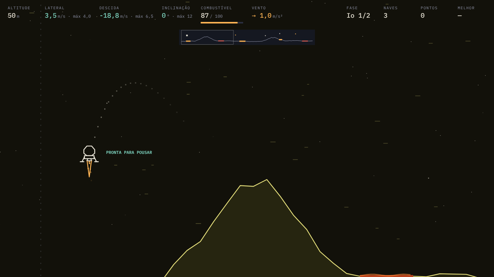
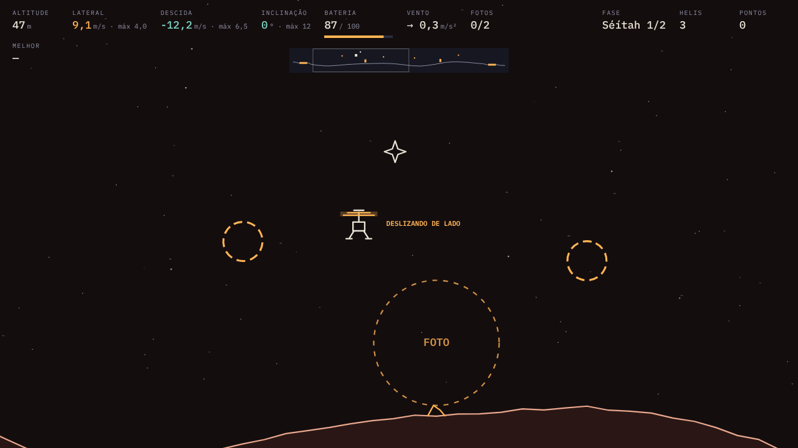
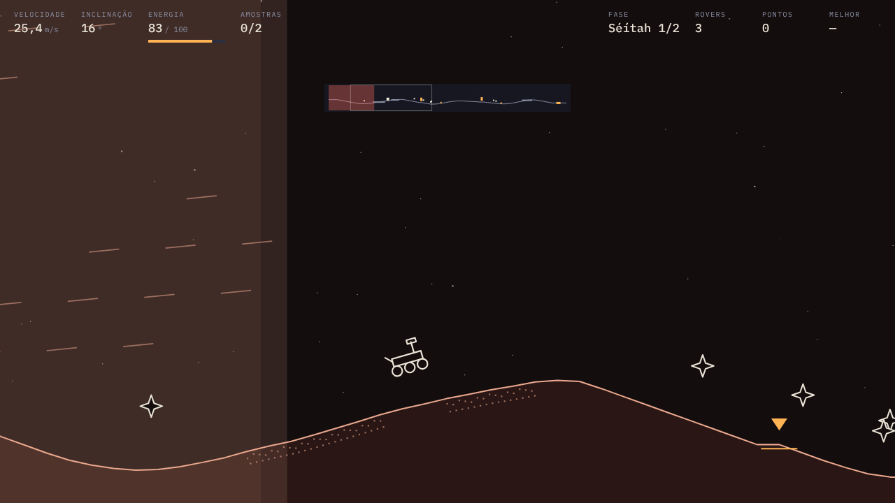
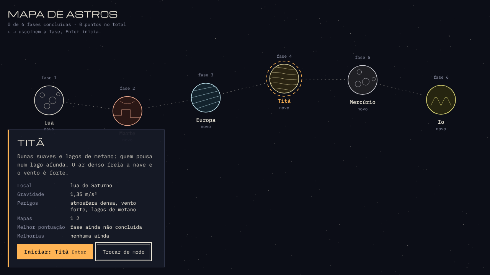

<div align="center">


# Lander Lunar

Pouse no Sistema Solar: um módulo de pouso em seis astros, um helicóptero e um rover em Marte.

<br>

[](https://github.com/LuccaBueno/lander-lunar/releases/latest/download/Lander-Lunar-Instalador.exe)


</div>

<br>



## Como instalar

1. Clique em **Baixar para Windows**, logo acima.
2. Abra o arquivo baixado, `Lander-Lunar-Instalador.exe`, e siga o instalador.
3. Se aparecer "O Windows protegeu o computador", clique em **Mais informações** e depois em **Executar assim mesmo**.

O jogo se atualiza por dentro dele: **Configurações > Verificar atualização**. Quando sai uma versão nova, ele também avisa sozinho na tela inicial. O progresso nunca se perde.

## Três modos de jogo

<table>
<tr>
<td width="50%"></td>
<td width="50%"></td>
</tr>
<tr>
<td><b>Ingenuity:</b> voe o helicóptero em Marte, fotografe os alvos, atravesse os aros e pouse no destino.</td>
<td><b>Perseverance:</b> corra com o rover, pule pedras e fendas, colete amostras e fuja da tempestade de areia.</td>
</tr>
</table>

No **módulo de pouso**, cada astro tem relevo e perigos próprios: crateras na Lua, cânions e vento em Marte, gêiseres em Europa, lagos de metano em Titã, meteoros em Mercúrio e vulcões em Io. Concluir uma fase libera a próxima, e as fases já jogadas podem ser repetidas pelo mapa.



## Controles

| | Módulo de pouso | Ingenuity | Perseverance |
|---|---|---|---|
| **← →** | giram a nave | inclinam o helicóptero | ré e acelerar |
| **↑** ou **Espaço** | motor | rotores | pular |

**P** pausa · **Z** zoom automático · **M** som · **F11** tela cheia. A dificuldade (fácil, normal ou difícil) fica em **Configurações**.

<br>

<details>
<summary><b>Para desenvolvedores</b></summary>

<br>

O jogo inteiro está em `src/index.html` (HTML, CSS e JavaScript, sem dependências); para testá-lo, basta abrir esse arquivo no navegador. O app de Windows é feito com [Tauri 2](https://tauri.app).

Para rodar como app, com [Node.js](https://nodejs.org) e [Rust](https://rustup.rs) instalados:

```
npm install
npm run dev
```

**Publicar uma versão nova** (com as mudanças já commitadas):

```
npm run versao 1.0.1 "O que mudou nesta versão."
```

O comando atualiza o número da versão, cria a tag `v1.0.1` e envia ao GitHub. O GitHub Actions gera o instalador e publica a Release com dois arquivos: `Lander-Lunar-Instalador.exe` e `latest.json`, que é o que o botão de atualização consulta. O texto entre aspas aparece para o jogador na tela de atualização. A versão nova precisa ser maior que a anterior.

**Chaves das atualizações:** o app só aceita atualizações assinadas com a chave privada do projeto, cadastrada em *Settings > Secrets and variables > Actions* como `TAURI_SIGNING_PRIVATE_KEY` e `TAURI_SIGNING_PRIVATE_KEY_PASSWORD`. A chave pública está em `src-tauri/tauri.conf.json`. A chave privada nunca deve ir para o repositório; sem ela não é possível publicar atualizações.

As fontes IBM Plex Mono e Michroma estão sob a SIL Open Font License (`src/fonts/`).

</details>
